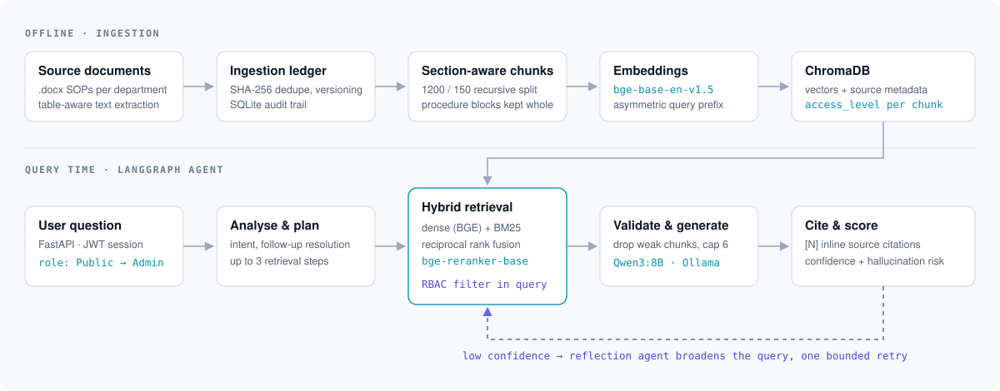
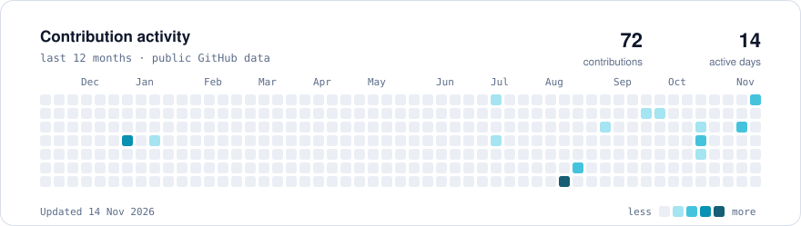
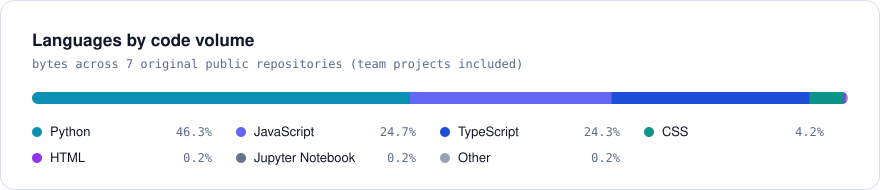

  
  
  

I'm a Computer Engineering undergraduate at **Sardar Patel Institute of Technology (SPIT), Mumbai**, working where software engineering meets applied AI. Most of what I build is about making language models answer from evidence: retrieval pipelines that find the right passage, scoring logic that stays deterministic, and evaluations that separate what the data shows from what it only suggests.

My strongest work so far is a **local agentic RAG system** for institutional documents, built during my internship at SP-TBI and now being written up as a research manuscript.

### Now

- Refining a manuscript on the Agentic AI Institutional Knowledge System's retrieval architecture and evaluation, for conference submission.
- Local-first RAG: hybrid dense + BM25 retrieval, cross-encoder reranking, and confidence-gated answers on Qwen3 via Ollama.
- LLM evaluation: how to measure grounding and cognitive demand in generated content without large labelled datasets.

 

## Featured work

### Agentic AI Institutional Knowledge System

**A local, citation-backed assistant that answers questions from a college's operating procedures, showing each user only what their role allows.**
&nbsp;[Code](https://github.com/adityam260206/Agentic-AI-Institutional-Knowledge-System) · Python · ~550 tests

<picture>
  <source media="(prefers-color-scheme: dark)" srcset="assets/architecture-dark.svg" />
  <source media="(prefers-color-scheme: light)" srcset="assets/architecture-light.svg" />
  
</picture>

| Decision | Why |
|---|---|
| **Hybrid retrieval, fused by rank (RRF, k = 60)** | Policy questions mix paraphrase and exact terms (form names, fee codes). Dense and BM25 scores live on different scales, so the two lists are fused by rank instead of by tuned weights. |
| **Cross-encoder reranking** (`bge-reranker-base`) | Re-scores fused candidates jointly with the query before the context is assembled. |
| **Access control inside the retrieval query** | Each chunk carries an `access_level`; the user's role becomes a ChromaDB `where` filter, so restricted text never reaches the prompt. Unknown roles fall back to Public. |
| **Agent graph with a reflection loop** (LangGraph) | Analyse → plan (≤ 3 steps) → retrieve → validate → generate → cite → score confidence. Low confidence triggers one bounded retry with a broadened query; otherwise the system declines rather than guesses. |
| **Fully local inference** (Qwen3:8B on Ollama) | Institutional documents never leave the machine. |
| **Idempotent ingestion** | SHA-256 deduplication, version supersession and a SQLite audit ledger; procedure blocks are kept whole during chunking. |

Also included: a FastAPI backend with JWT auth, streaming chat and an admin console; a retrieval benchmark comparing dense-only, hybrid and hybrid + reranker (Precision@K, MRR, Hit@K, latency); and Docker packaging.

 

<table>
<tr>
<td width="50%" valign="top">

#### HireLens
**Explainable AI recruitment platform**
 <a href="https://hirelens-pearl.vercel.app">Live demo</a> · <a href="https://github.com/adityam260206/hirelens">Code</a>

AI match scores in hiring are usually opaque and change between runs. HireLens computes them with a **pure, deterministic scoring engine** that outputs per-skill match and gap evidence. The LLM only writes a plain-English summary of numbers that are already final, so an AI outage never changes a score.

- Same engine in TypeScript and Python, kept in parity
- Pluggable LLM providers with schema-validated outputs
- Recruiter, interviewer and candidate roles with server-side authorization
- PDF/DOCX resume parsing; deployed on Vercel and Render

TypeScript · Next.js · Express · Prisma · PostgreSQL · Vitest

</td>
<td width="50%" valign="top">

#### AI-Assisted Educational Content Evaluation
**Which quiz-generation strategy produces grounded, demanding questions?**
 <a href="https://github.com/adityam260206/Content-Generator-AI">Code</a> · <a href="https://github.com/adityam260206/Scholera-Home-Assignment">Study write-up</a>

Compares **Full Context**, **Retrieval** and a two-pass **Generate → Verify** pipeline across seven dimensions: grounding, correctness, Bloom's-level cognitive demand, clarity, coverage, redundancy and yield.

- On the evaluated sample, Generate → Verify had 100% strongly grounded questions and the highest cognitive-demand score (1.250)
- Identifies confounders such as context length, chunk fragmentation and topic familiarity
- Proposes a larger randomized follow-up instead of over-reading a small sample

Python · TypeScript · Next.js · Gemini API · Jupyter

</td>
</tr>
<tr>
<td colspan="2" valign="top">

#### MSME360 &nbsp;team project · 2 contributors
**Multi-tenant operations platform for small businesses** · <a href="https://github.com/adityam260206/MSME">Code</a>

Inventory, purchasing, point of sale, CRM, finance ledger and analytics on a FastAPI + SQLAlchemy backend with Alembic migrations and four-tier role-based access. My part: rule-based credit-risk evaluation, the customer portal and ratings, the government-schemes module, and the deployment setup (Docker, Nixpacks, Procfile).

Python · FastAPI · SQLAlchemy · Alembic · React · Vite · pytest

</td>
</tr>
</table>

 

## Research

| Status | Work |
|---|---|
| **Manuscript in preparation** | *Agentic AI Institutional Knowledge System*: system design, hybrid retrieval architecture and evaluation. Being refined for conference submission. |
| **Completed study** | *AI-assisted educational content evaluation*: a comparison of three LLM quiz-generation strategies with confounder analysis (above). |
| **Interests** | Information retrieval · RAG · agentic AI · LLM evaluation and reliability · NLP · machine learning |

Questions I keep returning to: When does reranking earn its latency? How should a RAG system decide it doesn't know? How do you measure grounding when labelled relevance data is scarce?

 

## Toolkit

  

| Area | Tools I have used in projects |
|---|---|
| **LLM & retrieval** | LangGraph · Sentence Transformers (BGE) · cross-encoder reranking · BM25 · RRF · ChromaDB · Ollama · Gemini and Groq APIs · prompt engineering |
| **Machine learning** | scikit-learn · XGBoost · pandas · NumPy · Matplotlib · feature engineering · model evaluation |
| **Backend & data** | FastAPI · Flask · Express · SQLAlchemy · Prisma · PostgreSQL · SQLite · JWT and role-based access |
| **Engineering** | Git · Docker · pytest · Vitest · Vercel · Render |

 

## Experience & leadership

| Role | Focus |
|---|---|
| **Intern**, SP-TBI · Jun–Jul 2026 | Designed and built the agentic RAG institutional knowledge system above. |
| **ML Technology Intern**, Bharat Space Education Research Center · Jun–Jul 2026 | Data preprocessing, feature engineering and ML model development in Python. |
| **Vice Chairperson**, FACE Committee · Mar 2025 – present | Coordinate committee operations and task allocation across teams. |
| **Campus Ambassador**, E-Cell IIT Bombay · Jun–Jul 2026 | Outreach for entrepreneurship initiatives among students. |
| **Facilitator**, Google Cloud Arcade · Jul–Sep 2026 | Supported hands-on Google Cloud learning for participants. |

B.Tech Computer Engineering, SPIT (2024 – present) · Minor in Banking & Financial Management (Barclays) · MHT-CET 99.78 percentile

 

## Activity

<picture>
  <source media="(prefers-color-scheme: dark)" srcset="https://raw.githubusercontent.com/adityam260206/adityam260206/refs/heads/output/activity-dark.svg" />
  <source media="(prefers-color-scheme: light)" srcset="https://raw.githubusercontent.com/adityam260206/adityam260206/refs/heads/output/activity-light.svg" />
  
</picture>

<picture>
  <source media="(prefers-color-scheme: dark)" srcset="https://raw.githubusercontent.com/adityam260206/adityam260206/refs/heads/output/languages-dark.svg" />
  <source media="(prefers-color-scheme: light)" srcset="https://raw.githubusercontent.com/adityam260206/adityam260206/refs/heads/output/languages-light.svg" />
  
</picture>

**Recently updated**

<!-- RECENT:START -->
| Repository | What it is | Main language | Last push |
|---|---|---|---|
| [**MSME**](https://github.com/adityam260206/MSME) | MSME360: multi-tenant business operations platform (team project) | JavaScript | Nov 2026 |
| [**hirelens**](https://github.com/adityam260206/hirelens) | Explainable AI recruitment platform with deterministic, evidence-backed match scoring | TypeScript | Oct 2026 |
| [**Content-Generator-AI**](https://github.com/adityam260206/Content-Generator-AI) | Evaluation framework comparing three LLM quiz-generation strategies | TypeScript | Oct 2026 |
| [**Scholera-Home-Assignment**](https://github.com/adityam260206/Scholera-Home-Assignment) | Evidence-based evaluation of AI-generated quiz content | — | Aug 2026 |
<!-- RECENT:END -->

Cards and table refresh daily from the GitHub API via a workflow in this repository. No third-party stats service.

 

---

  <b>Retrieve before you generate. Measure before you claim.</b>
   
  <a href="https://www.linkedin.com/in/aditya-malekar-798515386/">LinkedIn</a> · <a href="mailto:adityam2602@gmail.com">adityam2602@gmail.com</a> · Mumbai, India

